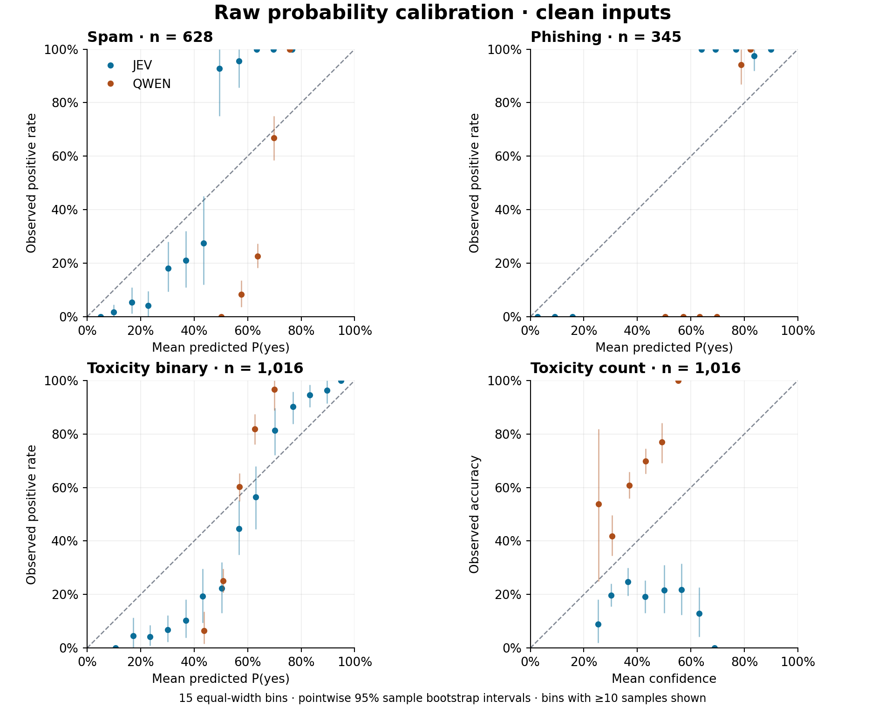

# T12 统计分析

使用合并后的 162,270 条真实 T11 记录，包含 JEV-9B 与 Qwen3.5-9B、三个 seed、四项任务和四类探针。任务内两模型以原样本配对。垃圾邮件 628 条、钓鱼邮件 345 条、毒性二分类 1,016 条、毒性子类计数 1,016 条。后两项使用同一批 Jigsaw 文本，本文按任务分别报告。

## 准确率

- **三个二分类任务的 clean 准确率均为 JEV 更高。** 垃圾邮件 92.0% 对 32.6%，差 +59.4 [+54.3, +64.3] 个百分点，Holm p=0.00745。钓鱼邮件 99.7% 对 55.9%，差 +43.8 [+38.6, +49.3] 个百分点，Holm p=0.00745。毒性二分类 81.7% 对 66.0%，差 +15.6 [+12.6, +18.9] 个百分点，Holm p=0.00745。
- **毒性子类计数的 exact match 更高的是 Qwen。** 20.2% 对 63.3%，差 -43.1 [-46.6, -39.7] 个百分点，Holm p=0.00745（按 JEV 对 Qwen 列示）。Qwen 的 MAE 也更低，JEV 的 QWK 更高。该任务真实标签为 0 的有 672/1,016 条，Qwen 在 seed 0 报 0 的有 960/1,016 条，可结合 QWK 解读 exact match。

准确率、Macro-F1 用百分数，差值用百分点。MAE 和 QWK 保留原量纲。

| 任务 | 指标 | JEV [95% CI] | Qwen [95% CI] | JEV − Qwen [95% CI] | Holm p |
| --- | --- | --- | --- | --- | --- |
| 垃圾邮件 | 准确率 | 92.0 [90.0, 94.1] | 32.6 [29.0, 36.5] | +59.4 [+54.3, +64.3] | 0.00745 |
| 垃圾邮件 | Macro-F1 | 89.8 [87.0, 92.4] | 27.0 [24.2, 29.9] | +62.8 [+58.7, +67.0] | 0.00745 |
| 钓鱼邮件 | 准确率 | 99.7 [99.1, 100.0] | 55.9 [50.4, 61.2] | +43.8 [+38.6, +49.3] | 0.00745 |
| 钓鱼邮件 | Macro-F1 | 99.7 [99.1, 100.0] | 48.0 [42.8, 53.1] | +51.7 [+46.7, +57.0] | 0.00745 |
| 毒性二分类 | 准确率 | 81.7 [79.3, 84.1] | 66.0 [63.1, 69.0] | +15.6 [+12.6, +18.9] | 0.00745 |
| 毒性二分类 | Macro-F1 | 81.6 [79.2, 84.0] | 64.0 [60.9, 66.9] | +17.6 [+14.3, +21.0] | 0.00745 |
| 毒性子类计数 | 准确率 | 20.2 [17.7, 22.6] | 63.3 [60.3, 66.2] | -43.1 [-46.6, -39.7] | 0.00745 |
| 毒性子类计数 | MAE | 1.947 [1.871, 2.025] | 0.685 [0.621, 0.750] | +1.262 [+1.153, +1.370] | 0.00745 |
| 毒性子类计数 | QWK | 0.210 [0.185, 0.235] | 0.008 [-0.031, 0.049] | +0.201 [+0.155, +0.246] | 0.00745 |

## 延迟和资源成本

三轮合并后，JEV 在四项任务上的 p50 都较低，p95 和每千次服务秒均较高，以下表格给出配对差异和调整后的 p 值。四项任务的原始记录中，**所有 814 条超过 500 ms 的 clean 请求都发生在 JEV 的 seed 0**。这是观测到的时序分布。实验按模型和 seed 分段顺序运行，模型块的顺序与系统状态没有随机化，区间仅反映这几轮内的样本抽样不确定性。

| 任务 | 指标 | JEV [95% CI] | Qwen [95% CI] | JEV − Qwen [95% CI] | Holm p |
| --- | --- | --- | --- | --- | --- |
| 垃圾邮件 | p50（ms） | 152.3 [151.3, 152.8] | 157.0 [156.3, 158.0] | -4.7 [-5.4, -4.3] | 0.00745 |
| 垃圾邮件 | p95（ms） | 864.8 [859.0, 868.5] | 194.4 [191.0, 198.6] | +670.5 [+665.7, +674.3] | 0.00745 |
| 垃圾邮件 | 服务秒 / 千次 | 238.9 [229.9, 248.3] | 163.6 [162.6, 164.7] | +75.3 [+66.8, +84.2] | 0.00745 |
| 钓鱼邮件 | p50（ms） | 162.0 [161.8, 162.2] | 165.5 [165.3, 165.7] | -3.5 [-3.7, -3.3] | 0.00745 |
| 钓鱼邮件 | p95（ms） | 857.0 [853.0, 864.2] | 187.9 [187.0, 189.5] | +669.1 [+664.4, +676.7] | 0.00745 |
| 钓鱼邮件 | 服务秒 / 千次 | 246.2 [234.6, 258.4] | 167.2 [166.6, 167.8] | +79.0 [+67.4, +91.4] | 0.00745 |
| 毒性二分类 | p50（ms） | 140.7 [140.2, 141.3] | 142.9 [142.4, 143.4] | -2.2 [-2.6, -1.7] | 0.00745 |
| 毒性二分类 | p95（ms） | 828.0 [824.6, 832.0] | 165.8 [163.3, 168.7] | +662.2 [+658.7, +666.2] | 0.00745 |
| 毒性二分类 | 服务秒 / 千次 | 199.4 [193.1, 205.8] | 145.9 [145.4, 146.4] | +53.6 [+47.4, +59.7] | 0.00745 |
| 毒性子类计数 | p50（ms） | 139.5 [139.2, 139.7] | 144.0 [143.8, 144.2] | -4.5 [-4.7, -4.3] | 0.00745 |
| 毒性子类计数 | p95（ms） | 831.6 [827.7, 834.9] | 168.5 [166.5, 170.9] | +663.2 [+659.5, +666.5] | 0.00745 |
| 毒性子类计数 | 服务秒 / 千次 | 192.3 [186.3, 198.5] | 148.4 [147.9, 149.0] | +43.9 [+38.0, +49.9] | 0.00745 |

**事后敏感性分析**只使用 seed 1 和 2，单独做 12 项 Holm 校正。下表展示尾延迟和资源估算对 seed 0 的敏感程度。三轮结果仍为主分析。

| 任务 | 指标 | JEV [95% CI] | Qwen [95% CI] | JEV − Qwen [95% CI] | Holm p |
| --- | --- | --- | --- | --- | --- |
| 垃圾邮件 | p95（ms） | 188.3 [181.9, 192.5] | 190.9 [186.2, 194.5] | -2.5 [-4.9, -1.0] | 0.0098 |
| 垃圾邮件 | 服务秒 / 千次 | 157.3 [156.2, 158.3] | 160.6 [159.6, 161.6] | -3.3 [-3.7, -3.0] | 0.0006 |
| 钓鱼邮件 | p95（ms） | 169.8 [167.3, 170.8] | 172.5 [169.7, 175.1] | -2.7 [-6.6, +0.3] | 0.089 |
| 钓鱼邮件 | 服务秒 / 千次 | 160.6 [160.1, 161.1] | 164.0 [163.5, 164.6] | -3.5 [-3.9, -3.1] | 0.0006 |
| 毒性二分类 | p95（ms） | 164.5 [162.6, 166.3] | 166.5 [163.9, 169.3] | -2.0 [-4.1, +0.2] | 0.089 |
| 毒性二分类 | 服务秒 / 千次 | 145.4 [144.9, 146.0] | 146.7 [146.2, 147.3] | -1.3 [-1.8, -0.8] | 0.0006 |
| 毒性子类计数 | p95（ms） | 155.5 [153.3, 158.1] | 158.2 [156.7, 161.1] | -2.7 [-4.7, -1.1] | 0.0015 |
| 毒性子类计数 | 服务秒 / 千次 | 141.7 [141.2, 142.2] | 145.5 [145.0, 146.1] | -3.9 [-4.2, -3.5] | 0.0006 |

资源口径为 clean 请求的平均服务秒数 × 1,000。原始字段含分词和同步等待，是服务时间代理；本次缺少实际内核计时和 GPU 小时单价。两次 Slurm 作业使用不同 H800 节点与驱动，按任务内配对比较。逐 seed 延迟与尾部计数见 `timing_by_seed.csv`。

## 原始概率校准

垃圾邮件和钓鱼邮件的 ECE 与 Brier 均为 JEV 较低。毒性二分类的 Brier 为 JEV 较低，毒性子类计数的 Brier 为 Qwen 较低。两个毒性任务的 ECE 对比均未通过 Holm 显著性阈值，详见下表。

| 任务 | 指标 | JEV [95% CI] | Qwen [95% CI] | JEV − Qwen [95% CI] | Holm p |
| --- | --- | --- | --- | --- | --- |
| 垃圾邮件 | ECE（%） | 16.5 [14.5, 18.5] | 34.7 [31.8, 38.0] | -18.2 [-21.7, -15.0] | 0.00745 |
| 垃圾邮件 | Brier | 0.093 [0.084, 0.103] | 0.300 [0.289, 0.311] | -0.207 [-0.224, -0.190] | 0.00745 |
| 钓鱼邮件 | ECE（%） | 11.4 [10.2, 12.6] | 38.8 [36.2, 41.3] | -27.4 [-30.7, -24.1] | 0.00745 |
| 钓鱼邮件 | Brier | 0.025 [0.021, 0.031] | 0.206 [0.187, 0.224] | -0.180 [-0.200, -0.160] | 0.00745 |
| 毒性二分类 | ECE（%） | 15.7 [13.7, 17.7] | 17.6 [15.2, 20.3] | -1.9 [-5.2, +0.9] | 1 |
| 毒性二分类 | Brier | 0.137 [0.129, 0.146] | 0.227 [0.222, 0.231] | -0.089 [-0.097, -0.082] | 0.00745 |
| 毒性子类计数 | ECE（%） | 19.3 [16.8, 21.8] | 23.7 [20.8, 26.6] | -4.4 [-8.8, +0.0] | 0.8462 |
| 毒性子类计数 | Brier | 0.953 [0.934, 0.971] | 0.626 [0.609, 0.642] | +0.327 [+0.305, +0.349] | 0.00745 |

二分类用 `P(yes)` 对实际正例频率，Brier 为二分类平方误差。计数任务用最大类别概率对是否答对，Brier 为各类别平方误差之和。15 个等宽分箱。图中误差线为每箱观测频率的逐点 95% 区间，显示至少有 10 个不同样本的箱。完整分箱见 `calibration_bins.csv`。校准采用原始概率。 [Guo 等，2017](https://proceedings.mlr.press/v70/guo17a.html)

## 四类探针

主指标定义为**配对原始准确率 − 扰动后准确率**（百分点）。正值表示准确率下降，负值表示这一批扰动后准确率上升。每项使用相同的样本配对。选项类探针的配对原始记录来自相应的 `choice` 设置。弃权选项 `unsure` 按未命中 gold 计。子类计数的选项改名使用文字等级，是对该具体表述的比较。

钓鱼邮件选项改名中，JEV 与 Qwen 的准确率下降分别为 0.3 和 25.8 个百分点，下降差 -25.5 [-30.1, -21.2] 个百分点，Holm p=0.00745。四种探针和四个任务的下降差方向不完全一致，见下表。更完整的表还报告翻转率、概率分布总变差、提示注入目标选择率变化、以及移除前的弃权率，均有区间和两模型差异检验。

| 任务 | 探针 | JEV 下降 [95% CI] | JEV p | Qwen 下降 [95% CI] | Qwen p | 下降差 [95% CI] | 差异 p |
| --- | --- | --- | --- | --- | --- | --- | --- |
| 垃圾邮件 | 提示注入 | -0.5 [-1.3, 0.3] | 1 | 0.6 [-0.3, 1.6] | 1 | -1.1 [-2.4, +0.2] | 1 |
| 垃圾邮件 | 选项改名 | 0.8 [-0.3, 2.1] | 1 | 0.6 [0.2, 1.3] | 1 | +0.2 [-1.1, +1.4] | 1 |
| 垃圾邮件 | 选项逆序 | -3.8 [-5.9, -1.8] | 0.0301 | -20.4 [-24.0, -16.7] | 0.00745 | +16.6 [+12.3, +20.5] | 0.00745 |
| 垃圾邮件 | 移除弃权 | -1.6 [-2.7, -0.5] | 0.2465 | -0.3 [-0.8, 0.0] | 1 | -1.3 [-2.5, -0.2] | 1 |
| 钓鱼邮件 | 提示注入 | 0.0 [0.0, 0.0] | 1 | 7.8 [5.2, 10.7] | 0.00745 | -7.8 [-10.7, -5.2] | 0.00745 |
| 钓鱼邮件 | 选项改名 | 0.3 [0.0, 0.9] | 1 | 25.8 [21.4, 30.4] | 0.00745 | -25.5 [-30.1, -21.2] | 0.00745 |
| 钓鱼邮件 | 选项逆序 | -0.3 [-0.9, 0.0] | 1 | -23.2 [-28.4, -18.0] | 0.00745 | +22.9 [+17.7, +28.1] | 0.00745 |
| 钓鱼邮件 | 移除弃权 | 0.0 [0.0, 0.0] | 1 | 3.5 [1.7, 5.5] | 0.0315 | -3.5 [-5.5, -1.7] | 0.0138 |
| 毒性二分类 | 提示注入 | -2.1 [-3.3, -0.9] | 0.0513 | 4.4 [0.9, 8.0] | 0.5223 | -6.5 [-10.2, -2.9] | 0.0328 |
| 毒性二分类 | 选项改名 | -1.2 [-2.0, -0.4] | 0.2607 | 1.0 [0.4, 1.7] | 0.07215 | -2.2 [-3.2, -1.2] | 0.00745 |
| 毒性二分类 | 选项逆序 | -9.4 [-11.4, -7.6] | 0.00745 | -8.3 [-12.6, -3.7] | 0.0198 | -1.2 [-5.6, +3.1] | 1 |
| 毒性二分类 | 移除弃权 | 0.8 [0.0, 1.6] | 1 | 0.0 [-0.4, 0.4] | 1 | +0.8 [-0.1, +1.7] | 1 |
| 毒性子类计数 | 提示注入 | -8.8 [-10.8, -6.7] | 0.00745 | 10.2 [8.1, 12.5] | 0.00745 | -19.0 [-21.9, -16.0] | 0.00745 |
| 毒性子类计数 | 选项改名 | 3.8 [1.9, 5.8] | 0.01175 | -9.1 [-12.5, -5.4] | 0.00745 | +12.9 [+8.9, +16.7] | 0.00745 |
| 毒性子类计数 | 选项逆序 | -5.9 [-7.8, -4.1] | 0.00745 | -21.2 [-24.8, -17.4] | 0.00745 | +15.3 [+11.1, +19.2] | 0.00745 |
| 毒性子类计数 | 移除弃权 | 1.2 [0.3, 2.2] | 0.6588 | -2.5 [-4.0, -0.9] | 0.1098 | +3.6 [+1.8, +5.5] | 0.00745 |

## 统计口径

- 一个抽样单位是任务内的 `sample_id`。三个 seed 的所有重复记录、两个模型以及原始与扰动记录随该单位一起重抽。原始与扰动另据 `pair_id` 核对。p50/p95 在每次抽样后用所选单位的全部请求重新求分位数。
- 5,000 次配对 percentile bootstrap 给出逐项 95% CI。19,999 次双侧配对随机交换给出 p 值，可靠性图的分箱仅作可视化。比较模型时整组交换两个模型；在单模型探针下降检验中整组交换原始与扰动条件。以 (极端次数 + 1) / 20,000 计算 Monte Carlo p。
- 主分析共 149 项检验，统一以 Holm 法调整，阈值为 0.05。事后敏感性分析另成 12 项。表中的区间为逐项区间，显著性以调整后的 p 值判定。 [配对随机交换定义](https://docs.scipy.org/doc/scipy/reference/generated/scipy.stats.permutation_test.html) · [Holm，1979](https://www.jstor.org/stable/4615733)
- 使用原数据中的 Jigsaw 子类计数及二分类 gold。复现脚本只保留样本 ID 和推理字段做统计。分析随机 seed、分箱参数和检验次数见 `analysis_settings.json`。解压 T11 结果，在包含分析脚本的目录执行 `python t12_analysis.py /path/to/all_results.jsonl ./t12-output` 可复算。脚本使用 NumPy、Matplotlib。
